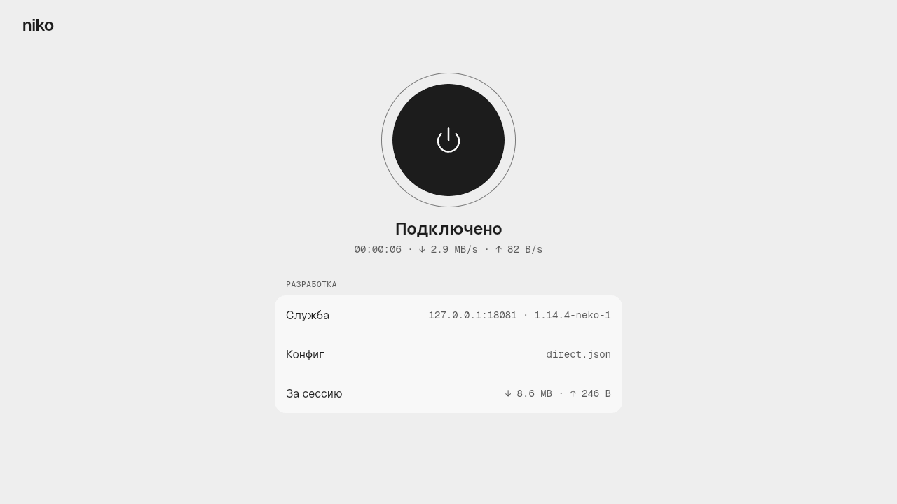

# Niko для компьютера: окно

Flutter, Windows сначала, Linux потом. Ядро и логика Niko живут в демоне (`boxdd` из форка ядра, дальше `nikod`);
окно только показывает и просит. Как устроено целиком — [docs/desktop/README.md](../docs/desktop/README.md), что
за каждым элементом экрана — [REQUIREMENTS.md](../docs/desktop/REQUIREMENTS.md).

Сейчас окно умеет то, что даёт уже готовый демон (`boxdd`), без `NikoService`:

- **Главная** (этап 2b): кнопка запускает готовый JSON-конфиг, видны статус, время и скорость (D-MAIN-02,
  D-MAIN-04, D-MAIN-06, D-MAIN-16).
- **Шапка** (D-NAV-01, D-NAV-03): разделы и переключатель вида «Простой / Расширенный». В шапке стоят только те
  разделы, у которых есть экран: в «Простом» — Главная и Журнал, в «Расширенном» ещё Соединения. Смена вида не
  трогает подключение и запоминается до следующего запуска (файл `window.json` в папке настроек пользователя:
  `%APPDATA%\Niko`, `~/.config/niko`, `~/Library/Application Support/Niko`). В узком окне (уже 760) разделы
  сворачиваются в три полосы слева от «niko», нажатие открывает их списком (`n-header--compact`, `n-menu`);
  список закрывают выбор, Escape и нажатие мимо.
- **Журнал** (D-LOG-01): строки ядра как есть, без цветовых кодов терминала; ошибки цветом опасности, отладка
  тише; новые строки держатся в поле зрения, пока пользователь сам не прокрутил вверх. Строки выделяются мышью и
  копируются Ctrl+C; кнопки: очистить журнал демона, скопировать весь журнал, сохранить его в файл
  (`niko-log-<дата>-<время>.txt` в «Загрузках», а без них в домашней папке; файл с тем же именем не заменяется).
  Хранятся последние 2000 строк.
- **Отчёты о сбоях** (D-LOG-02): если ядро упало или ему не хватило памяти, а отчёт ещё никто не сохранял, над
  журналом баннер с датой и действием «Экспорт»: архив демона (zip с отчётом и журналом ядра, **без конфига** —
  в нём ключи) сохраняется туда же, отчёт помечается прочитанным.
- **Инструменты** (D-LOG-03): справа от журнала, в узком окне под ним. «Поведение NAT»: STUN-проверка через
  основной исходящий подключения (`StartSTUNTest`; пустое поле — сервер демона по умолчанию). Показывает внешний
  адрес, задержку, а если сервер умеет RFC 5780 — сопоставление и фильтрацию NAT словами. Идёт только при
  подключённом ядре, иначе кнопка неактивна и об этом сказано.
- **Соединения** (D-CONN-01): куда, какая программа, по какому правилу, через что, сколько байт и как давно;
  поиск по любому из этих слов; закрыть одно и закрыть все.

Журнал и соединения читаются у демона только пока открыт их экран. Узла, списка способов, остальных разделов
(Узлы, Проверка маршрута, Правила, Настройки) ещё нет: они приходят с `NikoService` (этап 3). Не сделано в
готовых разделах: панель Clash API в инструментах и выбор папки при сохранении — сейчас
всегда «Загрузки»; узлы в сохранённом журнале не скрываются, как на телефоне (узлов окно ещё не знает).

**Связь с демоном не рвётся при остановке ядра.** Пакет `http2` на Dart закрывал всё соединение (PROTOCOL_ERROR,
«HTTP/2 clients cannot receive HEADER_FRAMEs»), когда окно отменяло поток соединений в тот же миг, когда демон сам
его закрывал. Это ловилось и против настоящего `boxdd`, и на Windows против тестового демона. Теперь при остановке
ядра окно не отменяет этот поток, а даёт ему закончиться (отменяет, только если он не закрылся за секунду). А если
работающая связь всё же оборвётся, окно сразу подключается снова и пишет «подключение», а не «служба не отвечает».
Тест с настоящим демоном требует, чтобы связь не рвалась ни разу до убийства демона.

## Что где

| Путь | Что |
|---|---|
| `lib/theme/tokens.g.dart` | Цвета, размеры и стили текста. **Сгенерирован** из `shared/tokens.json` (`shared/tool/gen_tokens.py`), руками не правится |
| `lib/ui/` | Компоненты дизайн-системы под теми же именами, что на холсте: кнопка подключения (`m-connect`), статус (`m-status`), баннер с действием, строки, шапка (`n-header`, `n-menu`), кнопка-значок, переключатель (`m-seg`), метка (`m-tag`), поле поиска |
| `lib/ui/icons.g.dart` | Значки окна. **Сгенерирован** из `shared/icons/lucide` (`shared/tool/gen_icons.py`, список `WINDOW`) — те же SVG, что у Android |
| `lib/platform/places.dart`, `lib/state/window_settings.dart` | Папки пользователя (настройки, «Загрузки») и запомненный вид |
| `lib/screens/shell.dart` | Окно под шапкой: какой раздел показан и в каком виде |
| `lib/screens/main_screen.dart` | Главная в виде «Простой». ID требований стоят в комментариях (`// D-MAIN-04`) |
| `lib/screens/log_screen.dart`, `tools_panel.dart`, `connections_screen.dart` | Журнал, инструменты рядом с ним, Соединения |
| `lib/state/connection_controller.dart` | Состояние подключения: связь с демоном, что делает ядро, трафик |
| `lib/state/log_feed.dart`, `connections_feed.dart` | Журнал и соединения: читают демон, пока открыт экран |
| `lib/state/stun_tool.dart` | Проверка NAT: шаги STUN-теста демона и итог |
| `lib/daemon/` | Клиент демона (gRPC) и адрес для режима разработки |
| `lib/gen/` | API демона на Dart. **Сгенерирован** из proto форка ядра (`tool/gen_proto.sh`) |
| `lib/l10n/strings.dart` | Тексты, русский и английский. Временно здесь: переедут в общий слой с текстами Android |
| `test/` | Тесты; `test/goldens/` — снимки экрана в состояниях |
| `windows/runner/resources/app_icon.ico` | Значок окна: знак «Маршрут». Собирается `tool/make_icon.js` и `tool/make_icon.py` |

Material не используется: компоненты свои, на слое `widgets`. Так окно легче, и выглядит как макет, а не как Android.

## Режим разработки

`boxdd run --listen 127.0.0.1:<порт>` — это gRPC по TCP **без какой-либо проверки клиента**: любой процесс машины,
дошедший до порта, управляет ядром. Поэтому:

- демон в этом режиме запускает только `tool/dev.dart`, и только на `127.0.0.1`;
- окно собирается со связью по TCP только с `--dart-define=NIKO_DEV=true`. Без него кода этой связи в сборке нет,
  что бы ни стояло в аргументах; релиз собирается без него;
- адрес разбирает `DevEndpoint`: `127.0.0.1:<порт>` и больше ничего — ни имени, ни другого адреса.

```
dart run tool/dev.dart --daemon <путь к nikod> --config <файл.json>
```

`nikod` — демон Niko: `boxdd` форка ядра и `NikoService` рядом (`libcore/cmd/nikod`; собирается из `libcore`:
`go build -tags=<теги ядра> ./cmd/nikod`). Для Windows и Linux его собирает `desktop.yml` (артефакт
`desktop-windows`, там же `boxdd` без `NikoService`). Конфиг — обычный JSON ядра; для пробы
хватит входа `mixed` на `127.0.0.1` и выхода `direct`.

## Проверки

```
flutter analyze
flutter test                      # всё, кроме теста с настоящим демоном
NIKO_DAEMON=<путь к nikod> flutter test test/real_daemon_test.dart   # без переменной тест пропускается
python3 ../shared/tool/gen_tokens.py --check
tool/gen_proto.sh --check <checkout форка ядра>
../shared/tool/gen_proto_go.sh --check   # NikoService для Go (libcore/nikopb)
```

- `test/daemon_link_test.dart` — клиент и состояние против поддельного демона по настоящему gRPC на `127.0.0.1`.
- `test/main_screen_test.dart` — экран в состояниях, клавиатура, подписи для диктора, узкое окно; снимки
  сравниваются с `test/goldens/` (на Linux; обновить — `flutter test --update-goldens`).
- `test/real_daemon_test.dart` — настоящий `boxdd`: запуск конфига, запрос через его прокси, счётчики трафика,
  остановка, убитый и вернувшийся демон. В CI идёт на Windows и на Linux.

Живой запуск (Linux, виртуальный экран, настоящий `boxdd`, трафик через прокси из конфига):



Шрифты Geist и Geist Mono — SIL Open Font License 1.1, текст в `fonts/OFL.txt`.
